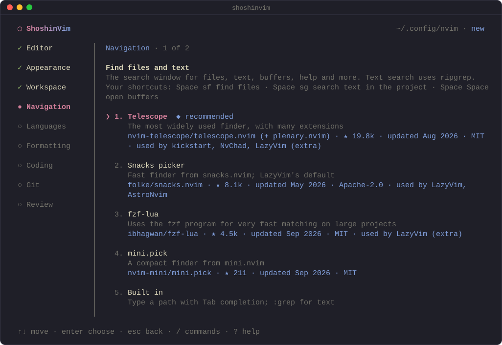
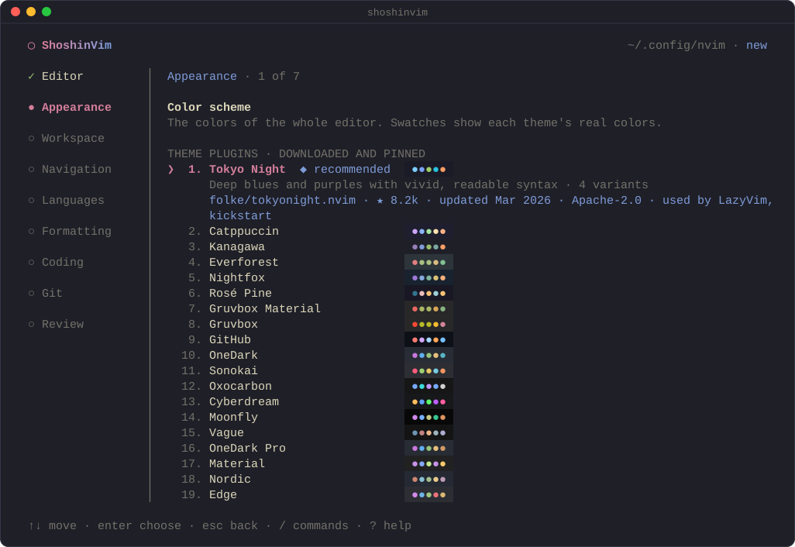
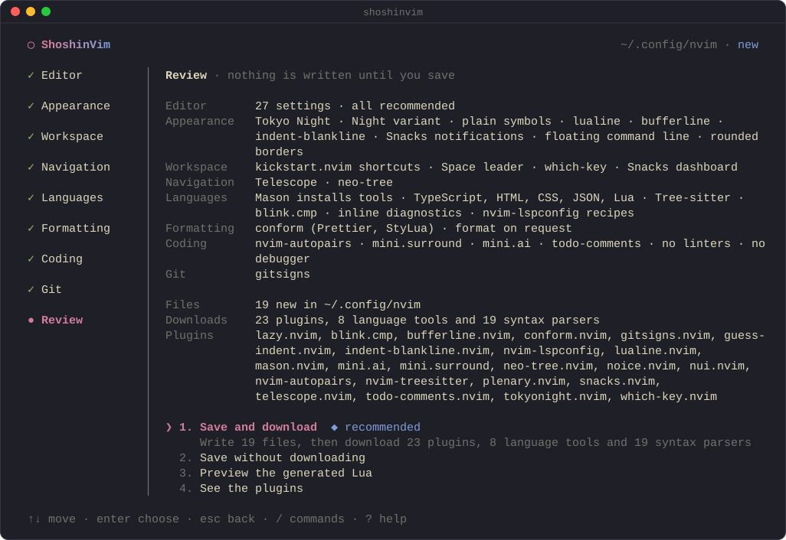
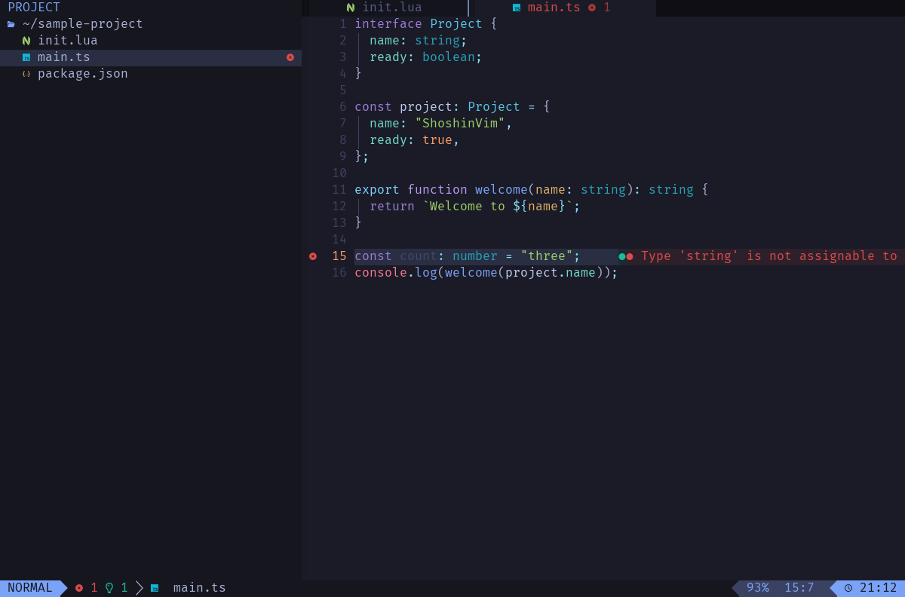
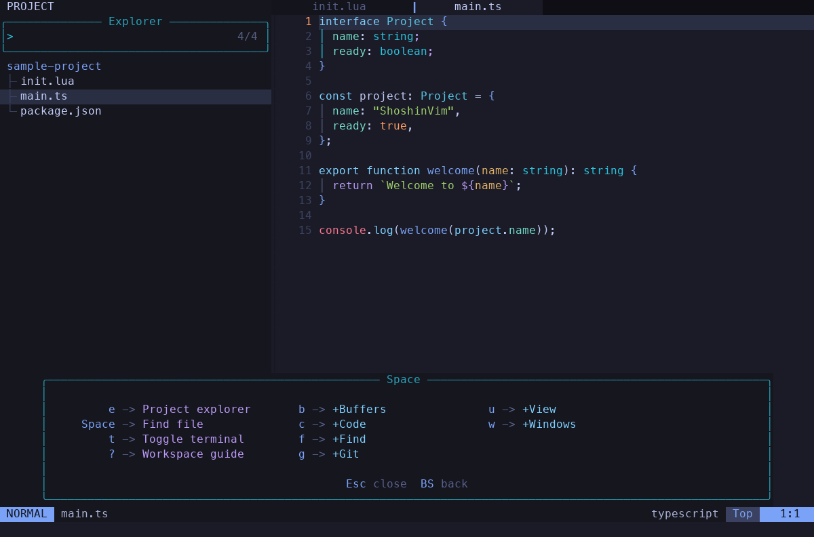

<div align="center">


**Build a Neovim you understand, one decision at a time.**

A guided setup in your terminal that writes plain Lua you own.

[](https://github.com/shoshindev/shoshinvim/actions/workflows/ci.yml)


[](LICENSE)

<sub>初心 · <i>shoshin</i> · beginner's mind</sub>

</div>

<br>



## Why ShoshinVim

- **One decision at a time.** Eight short sections each ask a few questions: Editor, Appearance, Workspace, Navigation, Languages, Formatting, Coding and Git. Every question marks one answer as recommended, following what kickstart.nvim, LazyVim, NvChad and AstroNvim ship, so Enter accepts it.
- **Plain Lua you own.** The result is an ordinary `init.lua` with modules under `lua/user_config/`, and it runs without ShoshinVim. Your own Lua goes in `user.lua`, which ShoshinVim never overwrites.
- **Nothing happens before review.** The review checks the configuration in an isolated Neovim and lists every file it would write and everything it would download. Saving backs up what it changes and can be rolled back.
- **Every plugin explained.** Each option names its repository, stars, last update, license and which starter configurations use it. Every plugin is pinned to an exact commit.

## A look at the setup

**Appearance.** 26 theme plugins with their variants, Neovim's built-in themes, or any theme from GitHub. Swatches show each theme's real colors.



**Your shortcuts.** kickstart.nvim's or LazyVim's keymaps, copied from their source and credited. Change any key, turn one off, or add your own before saving.


**Review.** A summary of every section, the files that would be written, and every plugin, language tool and parser that would be downloaded.



## What you get

Accepting every recommendation gives a cohesive workspace for Web and Lua development. Press Space and pause to see what each key does.

 

## What you can choose

| Section | Choices |
|---|---|
| Editor | 27 settings in one form, including indentation detection, highlight on copy, restore cursor, trim on save and spell check for prose |
| Appearance | 26 theme plugins, Neovim's built-in themes or any theme from GitHub · Nerd Font icons (mini.icons) or plain symbols, after a quick glyph test · lualine, mini.statusline or the built-in status line · bufferline, barbar, mini.tabline or no tabs · indent-blankline, Snacks or mini.indentscope guides · Snacks, fidget or built-in notifications · noice.nvim's floating command line or the built-in one |
| Workspace | kickstart.nvim or LazyVim shortcuts, or Neovim's defaults only, with any key changed, turned off or added · which-key or mini.clue hints · the Snacks dashboard or mini.starter |
| Navigation | Telescope, Snacks, fzf-lua, mini.pick or built-in search · neo-tree, nvim-tree, Snacks, oil, mini.files or netrw |
| Languages | 24 languages, each with its language server, formatter where one is common, and syntax parsers, installed by Mason or by you · nvim-treesitter parsers or built-in syntax · blink.cmp, nvim-cmp or built-in completion |
| Formatting | conform.nvim or the language servers' own formatting · on save or on request |
| Coding | nvim-autopairs or mini.pairs · mini.surround or nvim-surround · mini.ai text objects · todo-comments or mini.hipatterns · nvim-lint · nvim-dap with nvim-dap-ui or nvim-dap-view for JavaScript and TypeScript |
| Git | gitsigns or mini.diff |

The languages are TypeScript and JavaScript, HTML, CSS, JSON, Svelte, Lua, Python, Ruby, PHP, Bash, Elixir, Go, Rust, C and C++, Zig, Swift, Java, Kotlin, C#, YAML, TOML, Markdown, Dockerfile and Terraform.

## Install

ShoshinVim is a development alpha. It runs on macOS (Apple Silicon and Intel) and on Linux with glibc (x86_64 and ARM64).

You need Neovim 0.12 or later and Git. Some choices need more programs, and the review lists any that are missing before you save:

- Node.js and npm for web language tools, linters and the JavaScript debugger
- ripgrep for searching text across a project
- tree-sitter-cli 0.26.1 or later (Mason can download it), a C compiler, curl and tar for syntax parsers

ShoshinVim doesn't install these programs. To install ShoshinVim, run:

```sh
curl --proto '=https' --tlsv1.2 -LsSf https://github.com/shoshindev/shoshinvim/releases/latest/download/shoshinvim-installer.sh | sh
```

The installer puts one executable in `~/.local/bin` (or `$XDG_BIN_HOME`) after checking it against the release's `SHA256SUMS`. It doesn't use sudo, edit your shell profile or start anything. If that folder isn't on your PATH, the installer says so, and you add it yourself. [Read the installer](scripts/shoshinvim-installer.sh) before you run it.

## Get started

```sh
shoshinvim   # answer the questions, then review and save
nvim
```

ShoshinVim writes to `~/.config/nvim`. Arrow keys move, Enter chooses, Esc goes back and `/` opens the command menu. Nothing is written or downloaded until you save in the review.

If `~/.config/nvim` already holds a LazyVim, NvChad or personal configuration, ShoshinVim only reads it and never changes it. Build a separate configuration next to it with `NVIM_APPNAME`, the environment variable that tells Neovim which folder under `~/.config` to use. Use the same name for both commands:

```sh
NVIM_APPNAME=shoshin shoshinvim   # writes ~/.config/shoshin
NVIM_APPNAME=shoshin nvim
```

## Change it later

Run `shoshinvim` again, with the same `NVIM_APPNAME` if you used one. It opens your saved choices, so you can change any section, see which files change and save. Each save backs up the files it changes, and **Recovery & history** in the `/` menu restores an earlier version.

Put your own Lua in `lua/user_config/user.lua`. ShoshinVim creates it once and never overwrites it. Don't edit the other generated files. If you do, ShoshinVim won't save again until you move your change into `user.lua` and restore the generated version, as [Using ShoshinVim](docs/usage.md#your-files) shows.

## Update or uninstall

If you used the installer, `shoshinvim update` installs a newer release after showing its notes, and `shoshinvim uninstall` removes the executable. Neither touches your Neovim configuration, plugins or tools, and the configuration keeps working without ShoshinVim. ShoshinVim can't update plugins yet, so they stay at the commits it downloaded.

## Other ways to install

To pin a version or choose the folder:

```sh
curl --proto '=https' --tlsv1.2 -LsSf https://github.com/shoshindev/shoshinvim/releases/download/v0.1.0/shoshinvim-installer.sh \
  | sh -s -- --version v0.1.0 --install-dir "$HOME/bin"
```

To install by hand, download your platform's archive and `SHA256SUMS` from [Releases](https://github.com/shoshindev/shoshinvim/releases), check the archive, unpack it and put `shoshinvim` on your PATH:

```sh
shasum -a 256 -c SHA256SUMS --ignore-missing
tar -xzf shoshinvim_0.1.0_aarch64-apple-darwin.tar.gz
xattr -d com.apple.quarantine shoshinvim   # macOS only: lets an archive downloaded in a browser run
```

With the GitHub CLI, `gh attestation verify <archive> --repo shoshindev/shoshinvim` confirms that this repository's release workflow built the archive.

Windows is not in the release yet because it hasn't been tested on a real Windows machine. There, or to build from source, use Go 1.27.1:

```sh
git clone https://github.com/shoshindev/shoshinvim.git
cd shoshinvim
go build -trimpath -o bin/shoshinvim ./cmd/shoshinvim
```

## Documentation

For users:

- [Using ShoshinVim](docs/usage.md): the setup, where it writes, your files, changing your configuration later, troubleshooting and the command line

For contributors:

- [Implementation status](docs/implementation-status.md): what works today and what must be verified before a release
- [Configuration catalog](docs/configuration-catalog.md): the full planned scope, including features that aren't built yet
- [Interface specification](docs/interface-spec-v0.1.md) and [distribution specification](docs/distribution-spec.md)
- [Develop and verify](docs/development.md): tests, the real-Neovim suite and release tooling

## Credits

The shortcut styles are copied from [kickstart.nvim](https://github.com/nvim-lua/kickstart.nvim) and [LazyVim](https://github.com/LazyVim/LazyVim) and credited in the setup. Recommendations follow what they, [NvChad](https://github.com/NvChad/NvChad) and [AstroNvim](https://github.com/AstroNvim/AstroNvim) ship. The interface colors are inspired by [Kanagawa](https://github.com/rebelot/kanagawa.nvim). Every plugin ShoshinVim offers is listed with its repository and license in [`plugins.json`](internal/engine/data/plugins.json).

## License

ShoshinVim is licensed under the [Apache License 2.0](LICENSE). The material it adapts from kickstart.nvim, LazyVim, nvim-lspconfig and Neovim, and the Go modules built into the executable, keep their own licenses; see the [third-party notices](THIRD_PARTY_NOTICES.md).

The configuration files ShoshinVim generates are yours: the ShoshinVim authors place no conditions on how you use, change or share them.
