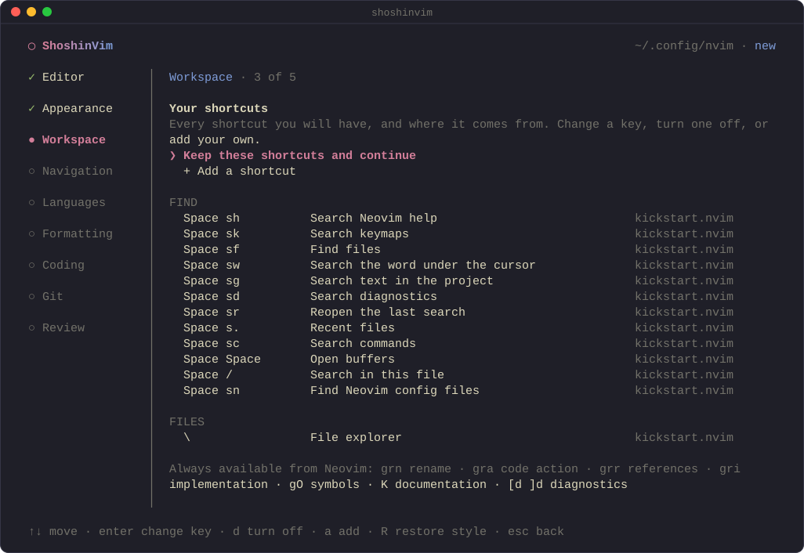

<div align="center">


**Build a Neovim you understand, one decision at a time.**

A guided setup in your terminal that writes plain Lua you own.

[](https://github.com/shoshindev/shoshinvim/actions/workflows/ci.yml)


[](LICENSE)

<sub>初心 · <i>shoshin</i> · beginner's mind</sub>

</div>

<br>


## Why ShoshinVim

- **One decision at a time.** Eight short sections — Editor, Appearance, Workspace, Navigation, Languages, Formatting, Coding and Git — each ask a few questions. Every question marks one answer as recommended, following what kickstart.nvim, LazyVim, NvChad and AstroNvim ship, so Enter accepts it.
- **Plain Lua you own.** The result is an ordinary `init.lua` with modules under `lua/user_config/`, and it runs without ShoshinVim. Your own Lua goes in `user.lua`, which is never overwritten.
- **Nothing happens before review.** The review checks the configuration in an isolated Neovim and lists every file it would write and everything it would download. Saving backs up what it changes and can be rolled back.
- **Every plugin explained.** Each option names its repository, stars, last update, license and which starter configurations use it. Every plugin is pinned to an exact commit.

## A look at the setup

**Appearance.** 26 theme plugins with their variants, Neovim's built-in themes, or any theme from GitHub. Swatches show each theme's real colors.


**Your shortcuts.** kickstart.nvim's or LazyVim's keymaps, copied from their source and credited. Change any key, turn one off, or add your own before saving.



**Review.** A summary of every section, the files that would be written, and every plugin, language tool and parser that would be downloaded.


## What you get

Accepting every recommendation gives a cohesive workspace for Web and Lua development. Press Space and pause to see what each key does.

 

## What you can choose

| Section | Choices |
|---|---|
| Editor | 27 settings in one form, including indentation detection, highlight on copy, restore cursor, trim on save and spell check for prose |
| Appearance | 26 theme plugins, Neovim's built-in themes or any theme from GitHub · Nerd Font icons (mini.icons) or plain symbols, after a quick glyph test · lualine, mini.statusline or the built-in status line · bufferline, barbar, mini.tabline or no tabs · indent-blankline, Snacks or mini.indentscope guides · Snacks, fidget or built-in notifications |
| Workspace | kickstart.nvim or LazyVim shortcuts, or Neovim's defaults only, with any key changed, turned off or added · which-key or mini.clue hints · the Snacks dashboard or mini.starter |
| Navigation | Telescope, Snacks, fzf-lua, mini.pick or built-in search · neo-tree, nvim-tree, Snacks, oil, mini.files or netrw |
| Languages | 24 languages, each with its language server, formatter where one is common, and syntax parsers, installed by Mason or by you · nvim-treesitter parsers or built-in syntax · blink.cmp, nvim-cmp or built-in completion |
| Formatting | conform.nvim or the language servers' own formatting · on save or on request |
| Coding | nvim-autopairs or mini.pairs · mini.surround or nvim-surround · mini.ai text objects · todo-comments or mini.hipatterns · nvim-lint · nvim-dap with nvim-dap-ui or nvim-dap-view for JavaScript and TypeScript |
| Git | gitsigns or mini.diff |

The languages are TypeScript and JavaScript, HTML, CSS, JSON, Svelte, Lua, Python, Ruby, PHP, Bash, Elixir, Go, Rust, C and C++, Zig, Swift, Java, Kotlin, C#, YAML, TOML, Markdown, Dockerfile and Terraform.

## Try it

ShoshinVim is a development alpha and has no release yet. Build it from source with Go 1.27.1; it needs Neovim 0.12 or later.

<!-- After the first release, the installer and Homebrew commands from docs/distribution-spec.md go here. -->

```sh
git clone https://github.com/shoshindev/shoshinvim.git
cd shoshinvim
go build -trimpath -o bin/shoshinvim ./cmd/shoshinvim
```

To try it next to an existing LazyVim, NvChad or personal configuration, give it its own name:

```sh
NVIM_APPNAME=shoshin-demo ./bin/shoshinvim   # walk through the sections, then review and save
NVIM_APPNAME=shoshin-demo nvim
```

Arrow keys move, Enter chooses, Esc goes back and `/` opens the command menu. An existing configuration that ShoshinVim did not create is only read, never changed.

Installing plugins needs Git. Web language tools, linters and the JavaScript debugger need Node.js and npm, and project text search uses ripgrep. Syntax parsers are compiled with tree-sitter-cli 0.26.1 or later (Mason can download it), a C compiler, curl and tar. The review lists anything missing; installing these runtimes is up to you.

## Documentation

- [Using ShoshinVim](docs/usage.md): the setup, where it writes, the command-line interface and your files
- [Implementation status](docs/implementation-status.md): what works today and what must be verified before a release
- [Configuration catalog](docs/configuration-catalog.md): the full roadmap
- [Interface specification](docs/interface-spec-v0.1.md) and [distribution specification](docs/distribution-spec.md)
- [Develop and verify](docs/development.md): tests, the real-Neovim suite and release tooling

## Credits

The shortcut styles are copied from [kickstart.nvim](https://github.com/nvim-lua/kickstart.nvim) and [LazyVim](https://github.com/LazyVim/LazyVim) and credited in the setup. Recommendations follow what they, [NvChad](https://github.com/NvChad/NvChad) and [AstroNvim](https://github.com/AstroNvim/AstroNvim) ship. The interface colors are inspired by [Kanagawa](https://github.com/rebelot/kanagawa.nvim). Every plugin ShoshinVim offers is listed with its repository and license in [`plugins.json`](internal/engine/data/plugins.json).

## License

ShoshinVim is licensed under the [Apache License 2.0](LICENSE). The material it adapts from kickstart.nvim, LazyVim, nvim-lspconfig and Neovim, and the Go modules built into the executable, keep their own licenses; see the [third-party notices](THIRD_PARTY_NOTICES.md).

The configuration files ShoshinVim generates are yours: the ShoshinVim authors place no conditions on how you use, change or share them.
