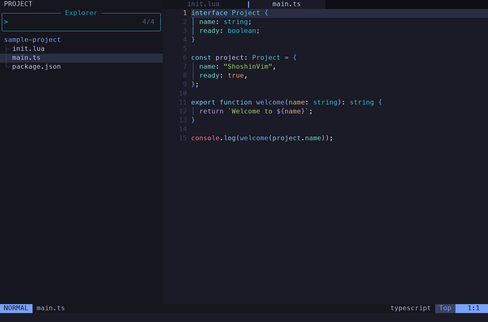
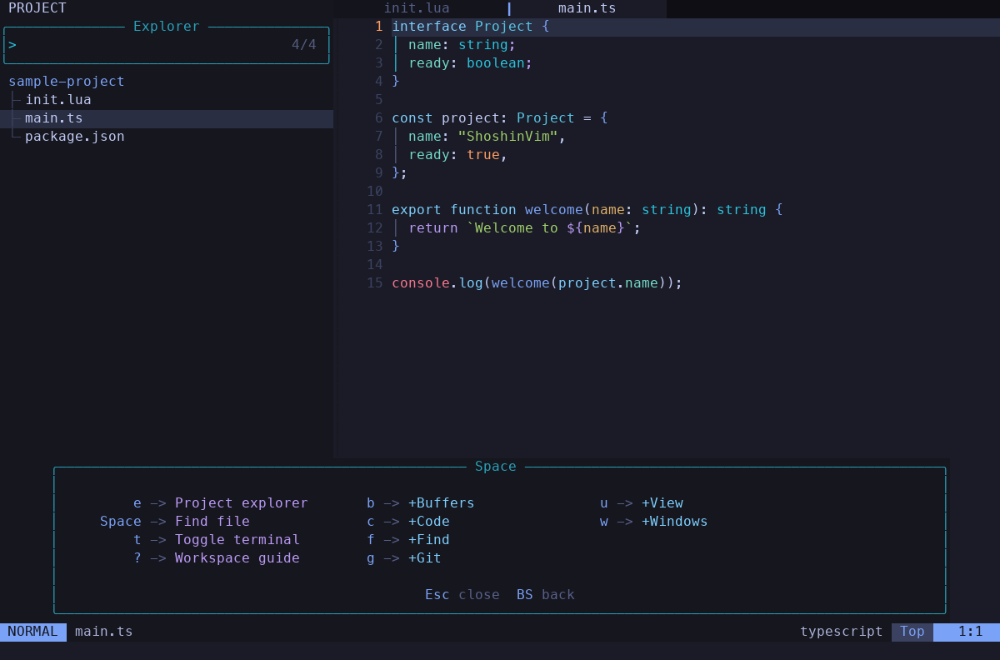

# Implementation status — development alpha

The product acceptance goal is a short, intuitive setup that creates a cohesive Rich IDE experience for Web and Lua. Visual polish and discoverability are part of that goal. Whether it feels better than LazyVim or NvChad requires hands-on user evaluation; compilation or a plugin list cannot establish that claim.

## Implemented in this checkout

| Area | Implementation | Validation / limits |
|---|---|---|
| Foundation | Go 1.27.1, Cobra, Charm v2, embedded catalog, GitHub repository renamed to `shoshindev/shoshinvim` | Local executable and five-platform snapshot archives; remote CI has not run for these uncommitted changes |
| Setup | Rich IDE language/formatting wizard, Minimal/Web/Lua/Custom proposals, explicit-choice preservation, undo | Model tests; actual POSIX terminal test |
| Terminal | Transcript, composer, commands, completion/palettes, history, focused viewers, responsive resize, plain output | macOS keyboard/resize/terminal-restoration checks; other platforms await CI and manual usability testing |
| Generation | Typed native metadata from Neovim 0.12.5, deterministic Lua serialization, scoped filetype settings, predefined keymaps | Real isolated Neovim validation, escaping/determinism tests; full curated help constraints remain to be expanded |
| Rich IDE | Tokyo Night, Lualine, Bufferline, which-key; Snacks dashboard/picker/explorer/input/terminal, task-oriented keymaps | Actual Neovim UI capture, without requiring a Nerd Font; a Web/Lua-specific preset, not the full future Balanced/Full IDE promise |
| Language support | Native LSP definitions plus optional lspconfig, native completion/snippets, diagnostics, Conform with Prettier/StyLua | Real ts_ls, html, cssls, jsonls and lua_ls attachment/completion; TypeScript diagnostics/hover; Prettier/StyLua formatting verified on macOS ARM64. Other platforms await CI. |
| Saving | Target identity, hashes, unmanaged/drift blocking, advisory lock, verified backup journal, staged replacements, verification, persisted-state commit, rollback/archive recovery | Injected phase failures, initial-write recovery, stale/tampered plans, symlink and lock tests; complete power-loss/disk-full platform matrix remains a release gate |
| Acquisition | Pinned Git revisions, staged download, Mason adapter, cancellation, progress receipts, retry without local rewrites | Isolated real downloads plus cancellation tests; registry/tool downloads can execute third-party install code only after approval |
| CLI | doctor, inspect, plan, apply, rollback, retry, update, uninstall, shell completions, man pages | Exported plan revalidation; updater/installer tests use local fixtures, not public production releases |
| Packaging | GoReleaser OSS archives/checksums, POSIX/PowerShell installer templates, Homebrew formula generator, GitHub provenance workflow | Local archive and checksum validation; release remains a draft until platform and clean-machine gates pass |

## Release gates still open

- Run and inspect the five-platform CI matrix and clean-machine end-to-end installation, upgrade, uninstall, rollback and crash-recovery scenarios. Cross compilation does not prove platform runtime behavior.
- Test PowerShell installer and executable replacement behavior on Windows. The updater reports a replacement failure without discarding the previous binary; a running-executable handoff needs Windows verification.
- Configure the protected GitHub `release` environment; publish a first verified draft release, attestations and a separately reviewed Homebrew tap. No production installation channel has been published.
- Complete broader terminal usability/accessibility sessions, including screen readers, below-minimum terminals, long Unicode paths, and signal/panic behavior on each platform.
- Expand curated option validation, profile/catalog migrations, dependency probe evidence and comparative metadata. Unknown schema/catalog versions are rejected today.
- Review the full interface acceptance checklist: transcript expansion, historical comparison, advanced editing and selection ergonomics are not all implemented.

## Catalog boundary

Available starting profiles: Rich IDE (Web/Lua), Minimal native, compact Web, compact Lua and Custom. Available manager: plugin-free or lazy.nvim. Available navigation: native, Snacks, mini.pick; explorer: native, Oil or Snacks. Git hunks: native diff or Gitsigns. Formatting: native LSP or Conform. Themes: native Neovim schemes or Tokyo Night. Rich appearance options each have a native fallback.

Planned until their own adapters and acceptance tests are complete: Balanced IDE, Full IDE, Writing and Remote profiles; Treesitter acquisition; Blink and other completion engines; linting; debugging/testing/task workflows; Python/Go/Rust and other language recipes; additional managers including experimental vim.pack; manager migrations; arbitrary plugin declarations; advanced autocmd editors; opt-in AI plugins and credential references.

The original specifications remain the complete product roadmap. This document distinguishes working alpha code from release evidence and future catalog coverage.

## Local verification record

On 2026-09-28, the isolated Rich IDE installation completed all nine pinned Git acquisitions and seven Mason package installations. Neovim 0.12.5 loaded the generated configuration independently, displayed the project sidebar/buffer tabs/statusline/shortcut guide, and attached ts_ls and lua_ls in the interactive UI. The separate headless integration exercised all five language servers and both formatters. The POSIX PTY test covered 120/80/52/40-column widths, the setup wizard, palettes, unsaved exit and restored terminal modes. GoReleaser produced all five snapshot archives and checksums locally; no release was published.

